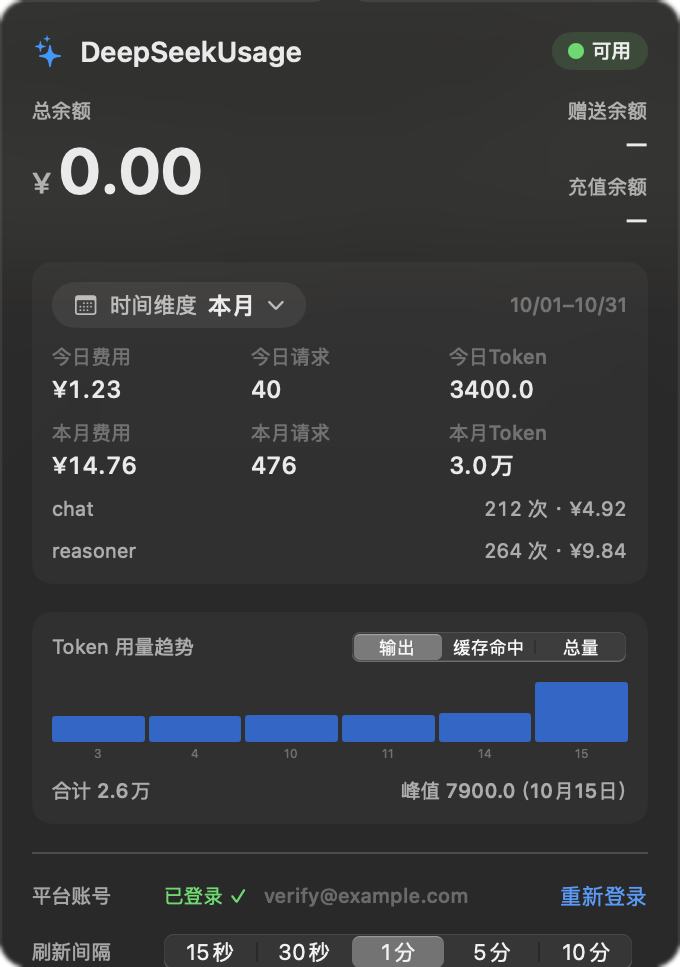
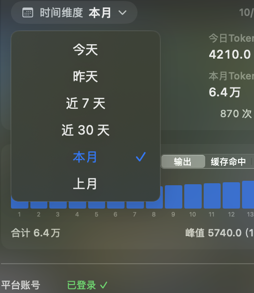
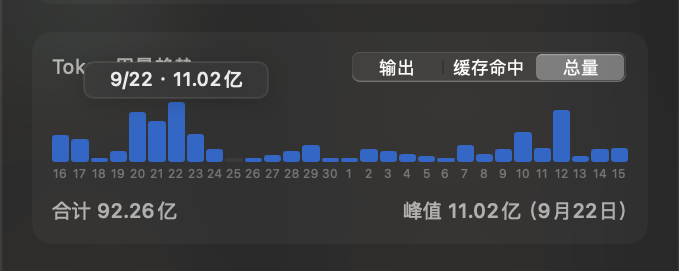
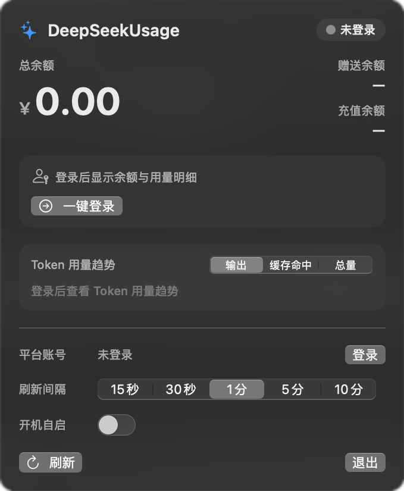

# DeepSeekUsage 🐳

[](LICENSE)
[](https://github.com/923106608-lang/DeepSeekUsage/releases)


English · [简体中文](README.md)

DeepSeekUsage is a lightweight, privacy-first **macOS menu bar app** that shows your DeepSeek platform account balance, spending and token usage in real time — from the menu bar and a popover panel. Data only flows between your Mac and the official DeepSeek endpoints; nothing is sent to any third party.

This project is a heavily customized fork of the open-source [DeepSeekMeter](https://github.com/CWNU-Open-Source-Community/DeepSeekMeter) project (by pppolf, MIT): fully Chinese UI, an added "time dimension" selector, platform-aligned usage metrics, chart enhancements, and more (see [Differences from upstream](#differences-from-upstream-deepseekmeter-v031)).

Current version: **v0.6.0** (macOS).

## Features

- **Menu bar resident**: the balance (`¥xx.xx`) is displayed right next to the menu bar icon; the title color changes at low balances (< ¥1 red / < ¥10 orange). Click the icon to open the panel.
- **Time dimension selector**: the "时间维度" (time dimension) button at the top of the panel switches between **Today / Yesterday / Last 7 days / Last 30 days / This month / Last month** (default: last 30 days). Options open in an overlay mini-popover that does not resize the main panel.
- **Balance**: total balance with gifted / recharged breakdown and wallet currency.
- **Usage metrics**:
  - Today's cost / requests / tokens
  - Dimension cost / requests / tokens (updates with the selected time dimension)
  - Token figures use the **total-token convention (input + output)**, matching the platform
- **Per-model breakdown**: calls and cost for each model (e.g. flash / v4-pro); costs from multiple API keys in the same currency are aggregated.
- **Token usage trend**: daily bar chart switchable between Output / Cache-hit / Total (default: Total); 30-day view labels every day on the x-axis; hovering a bar shows "date · daily tokens".
- **Auto-dismiss**: clicking anywhere outside the panel (or switching apps) closes it. This is built into the app source — no injection required.
- **Official login**: a one-click button opens the official DeepSeek login page; the session token is stored locally only.
- **Refresh interval** from 15 seconds to 10 minutes, manual refresh, and launch at login.

## Screenshots

| Main panel (signed in · demo data) | Time dimension selector (overlay popover) |
| :---: | :---: |
|  |  |
| **Token trend**: 30-day labels + hover tooltip | **Signed out**: one-click login prompt |
|  |  |

> Screenshots show demo / test data. A real run shows your own usage.

## Requirements

| Purpose | Requirement |
| :--- | :--- |
| Using the app | macOS 14 or later; Apple Silicon or Intel |
| Building from source | Xcode Command Line Tools (includes the Swift 6 toolchain; the macOS target does not require full Xcode) |

## Install and run

### Option 1: DMG (recommended)

1. Download `DeepSeekUsage-0.6.0-macOS.dmg` from the [Releases page](https://github.com/923106608-lang/DeepSeekUsage/releases).
2. Open the DMG and drag `DeepSeekUsage` onto the Applications shortcut.
3. If Gatekeeper blocks the first launch, **right-click → Open** (the build is ad-hoc signed; Developer ID notarization is not configured).
4. Click the menu bar icon → choose "一键登录" (one-click login) in the panel → sign in on the official DeepSeek page. The panel loads your data automatically after you return.

### Option 2: Build from source and install

```bash
bash Scripts/install.sh
```

This is equivalent to `swift build -c release` + assembling the `.app` + copying it into `/Applications` + launching it.

Notes:

- Time dimension: click the button, then click an option — it takes effect and collapses immediately.
- Clicking outside the panel (or switching apps) dismisses it; click the menu bar icon again to reopen.
- Missing menu bar icon: macOS may hide it when menu bar space is tight (common on notch models). Reduce other menu bar items in System Settings.
- This app is **independent** from upstream DeepSeekMeter and any older version (Bundle ID `com.deepseek.usage`); login state and settings are not shared, and both can coexist.

## Build from source

```bash
# Build (release)
swift build -c release

# Self-test (no Xcode / XCTest required)
bash Scripts/run-tests.sh

# Assemble the .app (icon generation + ad-hoc signing)
bash Scripts/build-app.sh release

# Run the assembled app
open build/DeepSeekUsage.app
```

> If a Developer ID Application certificate is present in your keychain, `build-app.sh` signs with it automatically; run `Scripts/notarize.sh` afterwards to notarize.

## Privacy and data

- Requests go directly from the app to DeepSeek private platform endpoints (`platform.deepseek.com`): `/auth-api/v0/users/current`, `/api/v0/users/get_user_summary`, `/api/v0/usage/by_api_key/amount`, `/api/v0/usage/by_api_key/cost`. These are not a public API contract and platform aggregation may be delayed.
- The app does **not** send tokens, balances, usage, telemetry or analytics to this repository's maintainer or any other third party.
- The session token is stored locally at `~/Library/Preferences/com.deepseek.usage.plist` (UserDefaults); no cloud configuration is written.
- Never paste a real token into issues, logs or screenshots.

## Repository map

```text
Sources/DeepSeekUsage/   macOS SwiftUI + AppKit menu bar app (the only build target)
Scripts/                 Build / install / self-test / icon generation / notarization scripts
windows/assets/          App and menu bar icon assets (whale girl; upstream path kept, used by the macOS build, attribution included)
images/                  UI screenshots
```

## Differences from upstream (DeepSeekMeter v0.3.1)

| Area | Change |
| :--- | :--- |
| Naming | Renamed to DeepSeekUsage; Bundle ID `com.deepseek.usage` (coexists with upstream) |
| New | "Time dimension" selector (Today / Yesterday / Last 7 days / Last 30 days / This month / Last month; overlay mini-popover) |
| Metrics | Today / dimension cost·requests·tokens; token counts switched to the total-token convention (input + output), matching the platform; same-currency multi-key cost aggregation |
| Trend | Output / Cache-hit / Total toggle (default: Total); per-day x-axis labels for the 30-day view; bar hover tooltip |
| Interaction | Click-outside-to-dismiss merged into the app source (no external injection) |
| UI | Fully Chinese |
| Scope | This repository keeps the macOS version only; Windows / iOS / Android sources live in the upstream repository |

## Changelog

| Date | Version | Change |
| :--- | :--- | :--- |
| 2026-10-15 | 0.6.0-r8 | Bar hover tooltip in the token trend chart (date · daily tokens) |
| 2026-10-15 | 0.6.0-r7 | 30-day x-axis now labels every day (adaptive cell width and font size) |
| 2026-10-15 | 0.6.0-r6 | X-axis date label fix (superseded by r7) |
| 2026-10-15 | 0.6.0-r5 | Metric corrections: total tokens (input + output), same-currency multi-key aggregation, Total as the default trend view, Last-30-days as the default dimension |
| 2026-10-15 | 0.6.0-r4 | Reset the time dimension popover state when the panel closes / reopens |
| 2026-10-15 | 0.6.0-r3 | Mini-popover finalized: 6 presets, overlay style, 150×172, centered labels |
| 2026-10-15 | 0.6.0 | Based on upstream v0.3.1: rename, time dimension, metric overhaul, click-outside-to-dismiss |

## FAQ

- **Session expired / data not updating?** Choose "重新登录" (log in again); or hit "刷新" (refresh).
- **"Cannot verify the developer" on first launch?** The build is ad-hoc signed: right-click → Open. Once only.
- **No menu bar icon?** Check the remaining menu bar space (macOS hides icons when space is tight); make sure the process is running (search DeepSeekUsage in Activity Monitor).
- **Launch at login does not stick?** Verify in System Settings → General → Login Items; the toggle mirrors that list.
- **How do I uninstall?** Quit the app → delete `/Applications/DeepSeekUsage.app` → delete `~/Library/Preferences/com.deepseek.usage.plist`; remove the login item if you enabled it.
- **Why macOS only?** This repository is a macOS-focused fork; see the upstream [DeepSeekMeter](https://github.com/CWNU-Open-Source-Community/DeepSeekMeter) for Windows / iOS / Android.

## Credits and license

- Based on [DeepSeekMeter](https://github.com/CWNU-Open-Source-Community/DeepSeekMeter) by pppolf (MIT).
- Icon asset attribution: see [windows/assets/ATTRIBUTION.md](windows/assets/ATTRIBUTION.md).
- This repository (including all modifications) is released under the [MIT](LICENSE) license.
- This is an unofficial third-party tool, not affiliated with DeepSeek.
